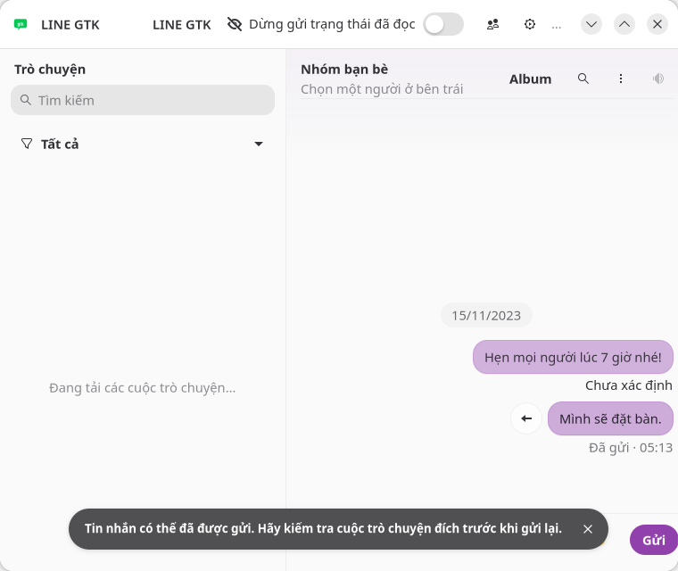
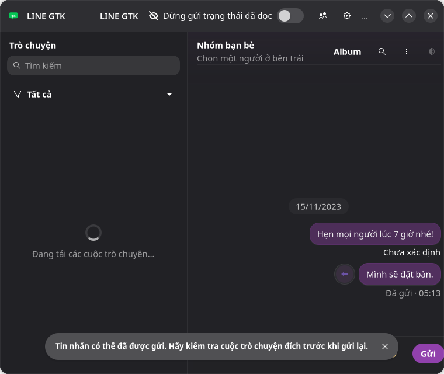

# M0 — Nền tảng gửi tin và khảo sát khả năng

Ngày: 2026-11-04. Phạm vi: M0 của [kế hoạch nhắn tin](messaging-features-plan.md). Đã triển khai đường gửi văn bản và kiểm thử cục bộ; chưa phát hành chọn nhiều tin, chuyển tiếp, ghim tin hoặc trả lời thông báo. Không gửi tin hay tạo announcement trên tài khoản LINE thật để kiểm tra tài liệu này.

## Ma trận loại tin

Đây là **chính sách cho các đợt tiếp theo**, không phải danh sách tính năng đã có. “Có text” chỉ dùng nội dung văn bản đã lưu, không trích nội dung HTML/Flex hoặc dữ liệu nội bộ vào clipboard. Mọi loại đều phải có ID server hợp lệ và không bị thu hồi/lỗi giải mã. Dòng ngày và sentinel không phải tin nhắn.

| Loại | Chọn (M1) | Sao chép (M1) | Lưu original (M1) | Chuyển tiếp | Ghim (M3) |
| --- | --- | --- | --- | --- | --- |
| TEXT / NONE / 0 | Có | Toàn bộ text | Không | Ứng viên M2a; gửi lại bằng tài khoản hiện tại | Ứng viên: text trong group |
| IMAGE | Có | Khi có text | Có, nếu còn original | M2b, sau khi xác minh nguồn và upload | Chưa mở |
| FILE | Có | Text/tên file | Có, nếu còn original | M2b, sau khi xác minh nguồn và upload | Chưa mở |
| VIDEO | Có | Khi có text | Chưa đưa vào batch M1 | Sau M2b | Chưa mở |
| AUDIO | Có | Khi có text | Chưa đưa vào batch M1 | Sau M2b | Chưa mở |
| STICKER | Có | Khi có text | Không chuyển sticker thành ảnh | Sau M2b, cần xác minh quyền sở hữu | Chưa mở |
| Flex / poll | Có | Khi có text | Không | Chưa mở; không mang theo action/metadata | Chưa mở |
| CALL / CHAT_EVENT / CHATEVENT / sự kiện nhóm | Không | Không | Không | Không | Không |
| UNSENT / pending / lỗi giải mã | Không | Không | Không | Không | Không |

## Đường gửi văn bản

`protocol/src/message_send.ts` tách chuẩn bị và submit. Adapter tạo request Talk bằng schema vendored, giữ metadata mention và ID trích dẫn dạng chuỗi. Nó kiểm tra phiên, trạng thái chặn và tin trích dẫn đã biết ở từng ranh giới await, bao gồm sau khi lấy sequence và ngay trước submit. Tin trích dẫn đã biết là thu hồi/lỗi giải mã bị từ chối; M0 giữ khả năng gửi reply bằng ID khi nguồn chưa có trong memory như trước. M2/M5 phải tự resolve và xác minh đầy đủ nguồn theo account/chat.

Đường cũ thử plain → encrypted → `chat.sendMessage` sau mọi lỗi có thể tạo tin trùng sau timeout. Đường mới:

1. Gửi plain một lần, tương thích hành vi ban đầu của client.
2. Chỉ chuyển sang encrypted khi nhận `InternalError` loại `RequestError` với mã `82` / `E2EE_RETRY_ENCRYPT` đã giải mã từ response. Không suy ra từ nội dung chuỗi lỗi.
3. Với group encrypted bị server từ chối bằng mã `99` / `E2EE_RECREATE_GROUP_KEY`, dùng helper khôi phục khóa hiện có, tạo envelope mới và thử tối đa một lần nữa. Kiểm tra phiên lại trước khi submit.
4. Các từ chối xác định trong allowlist (ví dụ `NOT_A_MEMBER`, `BLOCK_FRIEND`) trả `failed`. Timeout, reset, HTTP lỗi, response lỗi định dạng, mã hệ thống chưa xác định hoặc thiếu ID server trả `unknown`; không thử route khác.

Fetch của client có cổng kiểm tra phiên, bao gồm request do dependency chạy sau khi refresh token. Cổng vẫn tồn tại khi download tạm thay fetch để đếm tiến trình rồi khôi phục. Không sửa nguồn vendored. Lỗi chuẩn bị không xác định được ánh xạ sang mã lỗi chung; không chuyển response body/header từ transport vào UI.

Khi LINE xác nhận ID server, UI và response dùng cùng ID để hợp nhất với event nhận tin. Lỗi ghi cache sau đó không biến lần gửi đã xác nhận thành thất bại.

## Hợp đồng operation

`protocol/src/message_operations.ts` lưu operation trong memory theo client/phiên và account. Native client cấp ID dạng `text-<process generation>-<request ID>`. Client RPC cũ không gửi `operationId` vẫn dùng được; sidecar tạo UUID cho lần gọi đó.

```json
{"id":1,"method":"send_message","params":{"operationId":"text-1-1","chatMid":"c-example","text":"Hello","replyToMessageId":"9007199254740993123"}}
{"id":1,"ok":true,"result":{"operationId":"text-1-1","accountMid":"u-example","destinationChatMid":"c-example","state":"succeeded","sent":{"id":"9007199254740993124","createdTime":1700000000000,"contentType":"NONE"},"message":{"id":"9007199254740993124","text":"Hello","to":"c-example"}}}
```

Ví dụ response rút gọn các trường message không liên quan. ID tin là chuỗi, không làm tròn qua JavaScript `number`.

| Trạng thái | Ý nghĩa | Recovery |
| --- | --- | --- |
| `pending` | Đang chuẩn bị, chưa submit | Có thể hủy trước submit |
| `sending` | Request có thể đã rời client | Không hủy hoặc tự gửi lại |
| `succeeded` | Có ID server hợp lệ | Dùng lại kết quả; không submit lại |
| `failed` | Chuẩn bị thất bại hoặc server từ chối xác định | ID operation cũ giữ kết quả; chủ động gửi mới phải có ID mới |
| `unknown` | Có thể đã gửi, chưa có xác nhận đáng tin cậy | Kiểm tra đích trước khi chủ động gửi mới |
| `cancelled` | Hủy trước submit | ID cũ không chạy lại |

`message_operation_status` và `cancel_message_operation` nhận `{ "operationId": "..." }`. Chúng chỉ tra/hủy phần chưa gửi trong phiên hiện tại, không gọi gửi tin. Cancel sau `sending` giữ nguyên trạng thái. Operation trùng ID và payload được gom cùng promise/kết quả, kể cả `unknown`; đổi chat hoặc payload bị từ chối bằng `operation_payload_changed`.

Response thất bại của operation có `ok: false`, `error` và `result` chứa trạng thái/context ở trên. Validation trước khi tạo operation vẫn có thể chỉ trả `error`, giữ tương thích RPC cũ. Chưa có event tiến trình riêng; M2 sẽ bổ sung khi có batch.

Registry chỉ giữ fingerprint SHA-256, định danh, trạng thái và envelope server tối thiểu; không lưu text/path vào nhật ký. Giới hạn hiện tại là 1.024 operation mỗi phiên: khi đầy, từ chối operation mới bằng `message_operation_limit`, không âm thầm quên ID rồi submit lại. Không ghi journal ra disk, không tự khôi phục/gửi lại sau restart. Status của phiên cũ không còn tra được. Đây là dedupe cục bộ, không phải exactly-once trên LINE.

## GTK và recovery

Mỗi send callback giữ account và process generation. Callback từ tài khoản/process cũ không cập nhật UI. Timeout RPC, pipe write không rõ kết quả và lỗi sidecar không được hiểu là có thể gửi lại an toàn.

Bubble chưa rõ kết quả hiện **Chưa xác định**, tooltip và toast yêu cầu kiểm tra đích. Không tự đưa text đó về composer hoặc outbox. Nội dung bubble vẫn có thể sao chép bằng menu hiện có; bản nháp tiếp theo được giữ. Timeout RPC vẫn chấp nhận response xác nhận đến muộn để thay bubble bằng ID server. Bubble unknown hiện chỉ sống trong view đang mở; reload/restart không lưu hay phát lại nó.

Fixture GTK dùng sidecar giả, kiểm tra cả event đến trước response, đổi account/process, giữ bản nháp, nhãn của bốn ngôn ngữ và theme sáng/tối ở cửa sổ 760 × 640. Không thêm thao tác bàn phím hay thay read policy trong M0.




## Kết quả khảo sát media, announcement và notification

| Khả năng | Bằng chứng cục bộ | Điều chưa được chứng minh / quyết định |
| --- | --- | --- |
| Original cũ | `shared_media.ts` và adapter cache attachment kiểm tra account/chat, mask thu hồi, giữ raw retrieval source. Fixture có session change, original hết hạn, clear cache và dữ liệu gốc. `outgoing_media.ts` có upload theo loại media và đích | Chưa nối download → upload sang chat khác, chưa xác minh nhận trên LINE chính thức. Không dùng thumbnail hoặc URL/khóa xác thực của nguồn. M2b phải giữ bản sao tạm và kiểm tra thu hồi trước upload |
| Gửi lại IMAGE/FILE | Upload media và E2EE hiện có; fixture sticker-image chứng minh envelope/khóa/preview cho ảnh tổng hợp | Không coi fixture ảnh mới là bằng chứng chuyển tiếp file/ảnh cũ. Không có server-side forward wrapper đã xác minh |
| Announcement | `message_capabilities_test.ts` dùng fixture tổng hợp kiểm tra list/create/remove, link nguồn, `announcementSeq` i64 và các quyền `ANYONE_IN_CHAT`, `CREATOR_ONLY`, `NO_ONE`. `TalkMessage.announce()` chỉ cho text trong group/room | Chưa xác minh hạn mức, quyền thực tế, DM/room, event thay đổi hoặc đồng bộ thiết bị. M3 bắt đầu group text; phải đối soát bằng danh sách authoritative, không suy ra từ text giống nhau. Không thực thi URL từ response tùy ý |
| Notification action | `desktop_notify.rs` dùng notify-rust, `notifications.rs` có GIO fallback và cập nhật cùng notification | M5a khả thi qua action mở hộp soạn. Phải dùng token context ổn định; update notification hiện trả lại ticket cũ và giữ listener cũ, nên không được mặc định action nhận context tin mới |
| Inline reply | notify-rust 4.18.0 đã resolve trong `Cargo.lock`: XDG backend chỉ nhận action/close; `NotificationResponse::Reply` hiện dành cho macOS. GIO action không tự cung cấp text entry | M5b cần adapter Linux riêng và event nhận text đã xác minh; không bật inline reply chỉ vì daemon quảng cáo capability |
| Flatpak | Manifest cho phép `org.freedesktop.Notifications` | Chưa chạy native/Flatpak trên GNOME/KDE thật để kiểm tra action, app nền, notification bị thay thế và nhập text. Quyền D-Bus không chứng minh inline reply hoạt động |

Các fixture đều dùng dữ liệu tổng hợp, không chứa token/khóa/tin thật. Không có bằng chứng live để công bố chuyển tiếp, announcement hoặc inline reply tương thích với LINE/desktop thật. Các phép kiểm tra đó vẫn là điều kiện trước khi mở M2b/M3/M5b cho người dùng.

## Validation

- Snapshot M0 tách riêng khỏi các thay đổi food-poll/avatar/history chưa commit: `cargo check --offline --all-targets --all-features` passed; Deno check đầy đủ: 378 passed. Các số dưới đây ghi lại kiểm thử trên cây làm việc kết hợp trong lúc triển khai.
- `cargo fmt --all -- --check`, Clippy với `-D warnings` và Rust suite: 169 passed, 16 fixture cần display được đánh dấu ignored.
- Fixture `fixture_unknown_sends_keep_text_and_accept_late_confirmation`: passed riêng với display; ảnh sáng/tối ở trên.
- `deno task --config protocol/deno.json check`: 397 passed, gồm regression send, operation và announcement contract.
- Verify 244 file dependency; build sidecar offline ra `/tmp`, smoke ready/ping. Không đổi dependency hay thay binary sidecar đang dùng trong repo.
